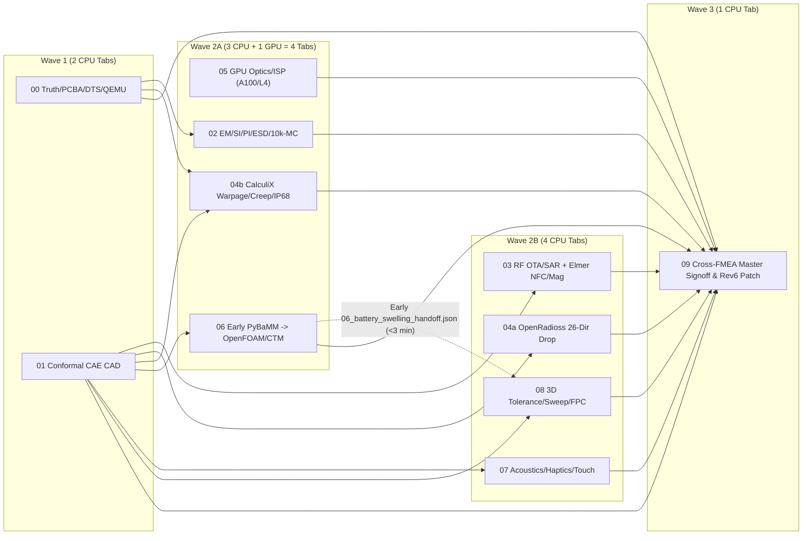

# RK T4 Flagship Rev 5.0 EVT — Ultimate Digital Twin Verification Suite (`colab_ultimate_signoff/`)

> **Goal:** Not merely "0 EDA DRC errors", but proving across **11 full-physics, EDA, CAD, EM, RF, Impact, Structural, GPU-Optical, CFD/Battery, Acoustic/Touch, 3D-Tolerance, and Cross-Domain FMEA notebooks** that RK T4 Rev 5.0 EVT (`14L Mainboard` + `8L RF Mezzanine` + `Camera/Display/Bottom Sub-Assemblies` + `Linux DTS`) can be ordered from JLCPCB / SMT tomorrow, assembled with real FPCs/coax/housing, and boot straight into MaskROM/Linux without shorts, solder floating, link failures, OLED burn-out, antenna shielding, or back-cover interference.

---

## 1-Click Launch Dashboard (Real GitHub URLs — Zero Placeholders)

| Wave | Notebook | Open in Colab | Recommended Colab Pro Runtime | `QUICK_CHECK` | `ULTRA_SIGNOFF` | Primary Solvers / Engines |
|---|---|---|---|---:|---:|---|
| **Wave 1** | `00_truth_boot_stackup_pcba_audit.ipynb` |  | CPU (Standard / High-RAM) | ~6 min | ~12–15 min | KiCad 9 (`kicad-cli` ERC/DRC/IPC-2581), `cpp`+`dtc`+`dt-validate`, `aarch64-linux-gnu-gcc` + `qemu-system-aarch64` |
| **Wave 1** | `01_cae_watertight_cad_prep.ipynb` |  | CPU (Standard / High-RAM) | ~3 min | ~7–10 min | Gmsh OCC (`occ.fragment()`, ASCII `v2.2`), `manifold3d`, STEP / Clean CalculiX `.inp` / STL |
| **Wave 2A** | `05_gpu_optics_isp.ipynb` |  | **GPU — A100 or L4 ONLY** | ~5 min | ~20–35 min | `Optiland` + PyTorch CUDA (91/153-pair ghost, TIR, 1000-MC), `Mitsuba 3` (`cuda_ad_rgb`) RAW→ISP |
| **Wave 2A** | `06_thermal_cfd_ctm_battery_safety.ipynb` |  | High-RAM CPU | ~10 min | ~45–75 min | **Early `PyBaMM`** (`06_battery_swelling_handoff.json`), OpenCFD `openfoam<YYMM>-default`, SciPy CTM+Leakage+DVFS ODE |
| **Wave 2A** | `02_em_si_pi_coldboot_esd_mc.ipynb` |  | High-RAM CPU | ~10 min | ~45–75 min | Headless `openEMS` 3D FDTD (`PML_8`), `scikit-rf`, `ngspice` (LPDDR5X eye, PDN, Coldboot, OVP, XTAL, ESD, 10k MC) |
| **Wave 2A** | `04b_static_creep_reflow_vib_ip68.ipynb` |  | High-RAM CPU | ~8 min | ~35–55 min | `CalculiX` (`ccx` — 5mm-Cu CLT Warpage, SAC305 `*CREEP` Darveaux, 2-Stage Bend/Modal, 2D Mooney-Rivlin IP68) |
| **Wave 2B** | `03_rf_anechoic_desense_coex_nfc_mag.ipynb` |  | High-RAM CPU | ~12 min | ~50–85 min | Headless `openEMS` (6-posture OTA/SAR + NF2FF 3m EMI), `scikit-rf` coax cascade, **`Elmer FEM`** (`WhitneyAVHarmonicSolver` NFC & 3D Magnetostatics) |
| **Wave 2B** | `04a_drop_bga_shock_retention.ipynb` |  | High-RAM CPU | ~12 min | ~55–90 min | `OpenRadioss` (`starter_linux64_gf` + `engine_linux64_gf`, 2-stage 26-dir drop, energy/hourglass QA, BGA & DF40C/MHF4 retention) |
| **Wave 2B** | `07_cpu_acoustics_haptics_touch.ipynb` |  | High-RAM CPU | ~8 min | ~30–45 min | `Elmer FEM` (`HelmholtzSolver` + ePTFE, `StatElecSolver` Touch SNR/Water), Klippel Nonlinear TS ODE, `CalculiX` LRA-OIS decoupling |
| **Wave 2B** | `08_3d_tolerance_assembly_fpc.ipynb` |  | CPU (Standard / High-RAM) | ~6 min | ~20–30 min | `manifold3d` (1000-MC w/ NB06 swelling, 4 functional clearances, 3D linear sweep + driver + SIM), `CalculiX` FPC 10k-cycle fatigue |
| **Wave 3** | `09_cross_fmea_master_signoff.ipynb` |  | CPU (Standard) | ~2 min | ~2–5 min | Pydantic v2 Schema & Provenance Anti-Spoofing Gate, 4 Cross-Domain Audits, DFMEA/PFMEA, **`RK_T4_MASTER_SIGNOFF_REPORT.html`**, **`rev6_patch_orders.json`** |

---

## Optimal Wave-Based DAG Execution Plan (Respects Colab Pro 3–4 Concurrent Session Limit & 90-Min Idle Timeout)

### How to Execute in 1 Click per Tab
1. Open the Wave 1 tabs (`00` + `01`), select **CPU**, leave `RUN_MODE = "ULTRA_SIGNOFF"` (or `"QUICK_CHECK"` for a fast 10-minute smoke pass), and click **Runtime → Run all**.
   - Wave 1 builds & caches `env_cpu_<codename>.tar.zst` and `apt_debs_<codename>.tar.zst` to Google Drive (`/content/drive/MyDrive/RK_T4_VirtualLab/bundles/`) via atomic lockfile + `os.replace()`.
2. Once Wave 1 finishes, close those 2 tabs and launch Wave 2A (`05` on **A100/L4 GPU**, plus `06`, `02`, `04b` on **High-RAM CPU**).
   - Notebook `06` executes `PyBaMM` **first** (before OpenFOAM CFD) and atomically writes `06_battery_swelling_handoff.json` within ~2–3 minutes.
3. Close Wave 2A tabs and launch Wave 2B (`03`, `04a`, `07`, `08` on **High-RAM CPU**).
   - Every multi-case solver (`02`, `03`, `04a`) checkpoints each completed case atomically to Drive and immediately `shutil.rmtree()`s `/tmp/rk_t4_work/<case_id>` — if Colab disconnects mid-wave, simply click **Runtime → Run all** again to resume from the exact next unfinished case!
4. Close Wave 2B tabs and run Wave 3 (`09_cross_fmea_master_signoff.ipynb` on **Standard CPU**) to produce:
   - `RK_T4_MASTER_SIGNOFF_REPORT.html` (interactive filterable dashboard)
   - `rev6_patch_orders.json` (actionable ECO list for every FAIL/WARN)
   - `RK_T4_EVT_TAPEOUT_CERTIFICATE.md`

---

## Core Architectural Guarantees
- **100% Read-Only Single Source of Truth:** Inputs are parsed dynamically from `hardware/`, `firmware/`, `src/`, `optics/`, and `mechanics/`. Every notebook concludes with `git diff --quiet HEAD -- hardware/ firmware/ src/ optics/ mechanics/`.
- **Strict ABI Isolation + Host CUDA Preservation:** Heavy CAE/CAD/EM/Optics workers run inside `/opt/rk_t4_env_<profile>/bin/python` via `run_in_env()`, never injecting incompatible C/C++/CUDA wheels into the live Jupyter kernel and always preserving `/usr/lib64-nvidia`, `/usr/local/nvidia/lib64`, and `/usr/local/cuda/lib64`.
- **No Threshold Softening & No Dummy-Box Provenance Spoofing:** Real Rev 5.0 design violations are honestly reported as `FAIL` and routed to `rev6_patch_orders.json`. Any `QUICK_CHECK` report or suspicious 1 mm³ dummy-cube `solver_provenance` automatically blocks EVT tapeout approval in Notebook `09`.
